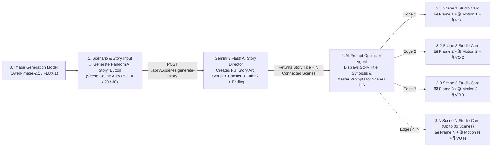

# AI Random Full Story Generator — Implementation Plan

> [!IMPORTANT]
> This plan adds a **1-Click "🎲 Generate Random Full Story (AI)"** capability to **Card 1 (`NodePrompt`)**. When clicked, **Gemini 3 Flash AI** invents a complete, multi-scene short film storyline from beginning to end (supporting **5, 10, 20, or 30+ scenes**), populates **Card 2** with all scene prompts, and dynamically spawns **separate Scene Studio Cards (`3.1 Scene 1`, `3.2 Scene 2`, ..., `3.N Scene N`)** arranged in a clean multi-column grid on the React Flow canvas.

---

## 1. End-to-End Architecture (Workflow Diagram)

---

## 2. User Interface Changes in Card 1 (`NodePrompt`)

Inside **Card 1 (`1. Scenario & Character Input`)**, we will add an **AI Full Story Generator Panel**:

1. **Story Scene Count Selector:**
   - Preset chips: **`Auto (AI)`**, **`5`**, **`10`**, **`20`**, **`30`**, plus a custom number input (`1` to `30`).
2. **Story Genre / Mood Selector (Optional):**
   - **`🎲 Surprise Me (Random)`**, **`Romantic Drama`**, **`Mystery / Thriller`**, **`Emotional Slice-of-Life`**, **`Action / Adventure`**, **`Sci-Fi Cinema`**.
3. **Primary Action Buttons:**
   - **`🎲 Generate Random Full Story (Scripts + Prompts)`**:
     - Calls the AI Story Director to invent a brand-new full story, fills Card 1 with the generated scene scenarios, fills Card 2 with all N optimized Master Prompts, and immediately spawns **N Scene Studio Cards** (`3.1` to `3.N`) with their complete Wan 2.2 Motion Scripts and Sinhala/English Voice-Over dialogues.
   - **`🎬 Generate Random Story + Render All Frames (GPU)`**:
     - Generates the full story first, spawns all N Scene Studio Cards, and then renders each scene's Master Frame Image **one-by-one sequentially** on the local RTX 4060 GPU so each card lights up with its finished image as soon as that scene completes!

---

## 3. Smart Multi-Column Canvas Grid for 10, 20, or 30 Scene Cards

When a story has **10, 20, or 30 scenes**, stacking all 30 cards in a single vertical column would make the canvas too tall. Instead, `getSceneCardPosition(sceneIdx, totalScenes)` in [App.jsx](file:///d:/film-argent/frontend/src/App.jsx) will arrange the spawned Scene Studio Cards in a **clean multi-column storyboard grid** to the right of Card 2:

| Total Scenes (N) | Grid Layout (Right of Card 2) | Coordinates Formula (`col`, `row`) |
| :--- | :--- | :--- |
| **1 – 3 Scenes** | Single vertical column (`1 × N`) | `x = 1385`, `y = 20 + idx * 690` |
| **4 – 12 Scenes** | 4-row columns (`4 scenes per column`) | `col = Math.floor(idx / 4)`, `row = idx % 4` `x = 1385 + col * 480`, `y = 20 + row * 690` |
| **13 – 30 Scenes** | 5-row storyboard grid (`5 scenes per column`) | `col = Math.floor(idx / 5)`, `row = idx % 5` `x = 1385 + col * 480`, `y = 20 + row * 690` |

Each card (`scene-1` through `scene-N`) receives its own color-coded animated edge (`e2-scene-1` ... `e2-scene-N`) coming from **Card 2 (`id: '2'`)**.

---

## 4. Backend Changes

### A. [schemas.py](file:///d:/film-argent/backend/app/schemas/schemas.py)
- Add `RandomStoryRequest`:
  - `scene_count: Optional[int] = None` (`None` = AI chooses optimal count between 6 and 15, or exact user count up to 30)
  - `genre: str = "random"`
  - `flux_model: str = "Qwen-Image-2.1"`
  - `aspect_ratio: str = "16:9"`
  - `characters: List[str] = ["male", "female"]`
- Add `story_title: Optional[str] = None` and `story_synopsis: Optional[str] = None` to `MultiScenePlanResponse`.

### B. [scene_planner.py](file:///d:/film-argent/backend/app/services/scene_planner.py)
- Add `async def generate_random_full_story(...) -> MultiScenePlanResponse`:
  - Uses **Gemini 3 Flash (`gemini-3-flash-preview`)** to write a cohesive, multi-scene short film featuring **Arjun (`arjun_male`)** and **Maya (`maya_female`)**.
  - Enforces narrative continuity across all N scenes:
    - **Act I (Scenes 1 .. 25%):** Establishing setting, character introduction, and inciting moment.
    - **Act II (Scenes 26% .. 75%):** Rising emotional interaction, plot progression, changing camera angles, and connected Sinhala/English dialogue.
    - **Act III (Scenes 76% .. 100%):** Emotional climax and memorable cinematic ending.
  - For large scene counts (e.g. 15–30 scenes), processes in structured batches so Gemini 3 Flash never truncates JSON output, and includes a rich multi-act local story generator fallback.

### C. [routes_scenes.py](file:///d:/film-argent/backend/app/api/routes_scenes.py)
- Add `POST /api/v1/scenes/generate-random-story` endpoint returning `MultiScenePlanResponse`.

---

## 5. Progressive Scene-by-Scene GPU Frame Rendering

When rendering images for a 10, 20, or 30-scene story:
- Instead of waiting for all 20 scenes to finish before showing any image, [App.jsx](file:///d:/film-argent/frontend/src/App.jsx) will render scenes **sequentially one scene at a time** (or allow clicking **`Generate Scene K Frame`** on any individual Scene Card).
- As soon as **Scene 1's frame** finishes on the RTX 4060 GPU, **`3.1 Scene 1 Studio Card`** immediately displays Scene 1's image while **`3.2 Scene 2 Studio Card`** begins rendering on the GPU!

