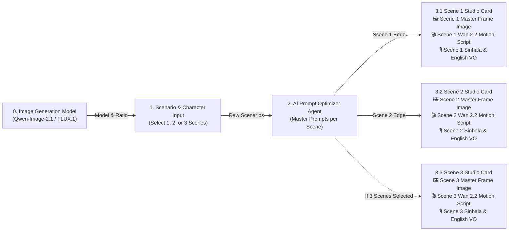

# Dynamic Scene Studio Cards — Implementation Plan

> [!IMPORTANT]
> This plan merges **Card 3 (Frame Image Studio)** and **Card 4 (Video Motion & Voice-Over Script)** into a unified **Scene Studio Card (`NodeSceneStudio`)** and dynamically spawns **1, 2, or 3 Scene Cards** connected from **Card 2 (`2. AI Prompt Optimizer Agent`)** based on the user's selected Scene Count.

---

## 1. Architectural Overview (Workflow Diagram)

---

## 2. How the Dynamic Node Graph Works

| Selected Scene Count in Card 1 | Nodes Connected After Card 2 | React Flow Edges from Card 2 |
| :--- | :--- | :--- |
| **`1 Scene`** | `scene-1` (**Scene 1 Studio Card**) | `e2-scene-1` (`source: '2'`, `target: 'scene-1'`) |
| **`2 Scenes`** | `scene-1` (**Scene 1 Studio Card**) `scene-2` (**Scene 2 Studio Card**) | `e2-scene-1` (`source: '2'`, `target: 'scene-1'`) `e2-scene-2` (`source: '2'`, `target: 'scene-2'`) |
| **`3 Scenes`** | `scene-1` (**Scene 1 Studio Card**) `scene-2` (**Scene 2 Studio Card**) `scene-3` (**Scene 3 Studio Card**) | `e2-scene-1` (`source: '2'`, `target: 'scene-1'`) `e2-scene-2` (`source: '2'`, `target: 'scene-2'`) `e2-scene-3` (`source: '2'`, `target: 'scene-3'`) |

---

## 3. Unified Scene Studio Card (`NodeSceneStudio`) Layout

Each dynamically generated **Scene N Studio Card** (`id: 'scene-1'`, `'scene-2'`, `'scene-3'`) contains **both** the Frame Image and the Video/Voice-Over Script for that specific scene:

1. **Card Header:**
   - Title: **`3.1 Scene 1 Studio — Frame & Script`** (or `3.2 Scene 2 Studio`, `3.3 Scene 3 Studio`)
   - Badges: Active GPU Model (`Qwen-Image-2.1` / `FLUX.1-dev`) + Scene Duration (`5s`)
2. **Section A — Master Frame Image (Top Half):**
   - Displays the generated 16:9 / 9:16 / 1:1 photorealistic **Master Frame Image** for Scene N.
   - Live GPU Progress Bar (`Step X/16`) shown directly inside Scene N's card while that scene is rendering on the RTX 4060 GPU.
   - Metadata strip: **Inference Engine**, **Camera & Lens Setup**, **Lighting**, and **Seed**.
   - Action buttons: **`Regenerate Scene N Frame (GPU)`** and **`Download PNG`**.
3. **Section B — Video Motion & Voice-Over Script (Bottom Half):**
   - **1. Wan 2.2 Video Motion Script (Editable + Copy Button):**
     - Camera motion badge (`Slow cinematic dolly push-in at 24fps`, etc.)
     - Full 5-second Image-to-Video (I2V) choreography prompt for Scene N.
   - **2. Short Film Voice-Over / Dialogue Script (Editable + Copy + Play Audio):**
     - Speaker badge (`Arjun (Male Lead)` / `Maya (Female Lead)`)
     - **Sinhala / Singlish Voice-Over** textarea + Copy button
     - **English Voice-Over / Subtitle** textarea + Copy button + **`Play VO Audio`** (Web Speech synthesis)
     - Ambient **SFX & Music Cue** footer
   - Action button: **`Regenerate Scene N Script & Voice-Over`**.

---

## 4. Files to Modify

### A. [CustomNodes.jsx](file:///d:/film-argent/frontend/src/nodes/CustomNodes.jsx)
- Create the new unified **`NodeSceneStudio`** component combining the image preview, live GPU progress bar, metadata grid, frame regeneration/download controls, and the editable Wan 2.2 Video Motion + Sinhala/English Voice-Over script sections for a single scene (`sceneIndex`, `sceneNumber`, `frame`, `sceneScript`).

### B. [App.jsx](file:///d:/film-argent/frontend/src/App.jsx)
- Register `sceneStudioNode: NodeSceneStudio` in `nodeTypes`.
- Add a helper `syncSceneNodesAndEdges(sceneCount, currentNodes, ...)` that dynamically creates/removes `scene-1`, `scene-2`, `scene-3` nodes (positioned cleanly at `x: 1390`, stacked vertically with spacing) and their corresponding animated edges (`e2-scene-1`, `e2-scene-2`, `e2-scene-3`) from Card 2 (`id: '2'`).
- Update `onSetSceneCount(cnt)` so clicking **`1 Scene`**, **`2 Scenes`**, or **`3 Scenes`** in Card 1 immediately updates the React Flow canvas with 1, 2, or 3 connected Scene Studio Cards.
- Update `onOptimizeAllScenes`, `generateImagesFromCard2`, `onRegenerateScene`, `onRegenerateFrame`, `startNewGeneration`, and `loadHistoryRun` so each Scene N Studio Card receives its own `sceneScript` and `frame` data.

